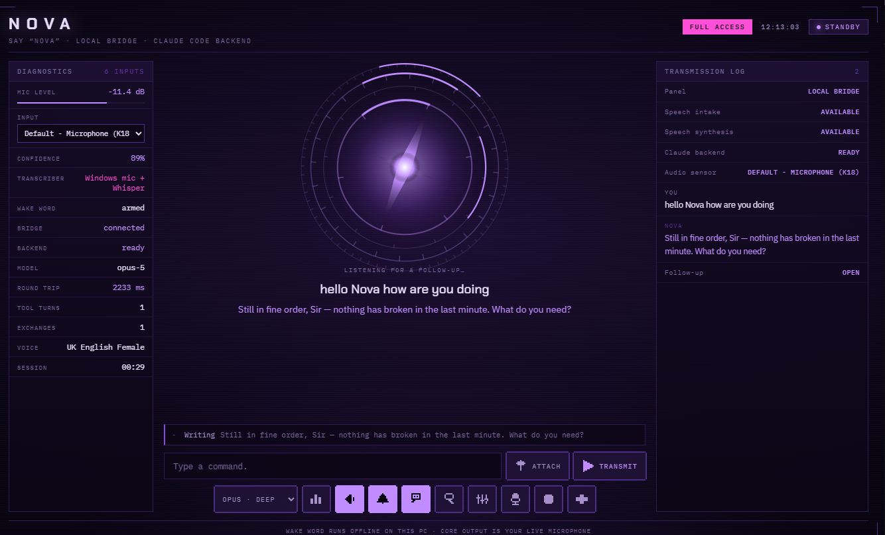
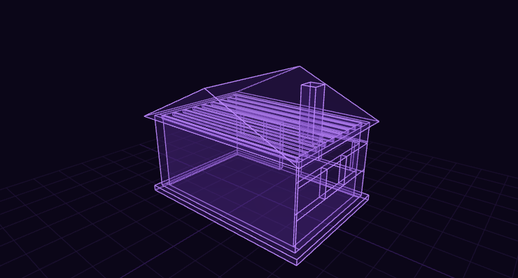
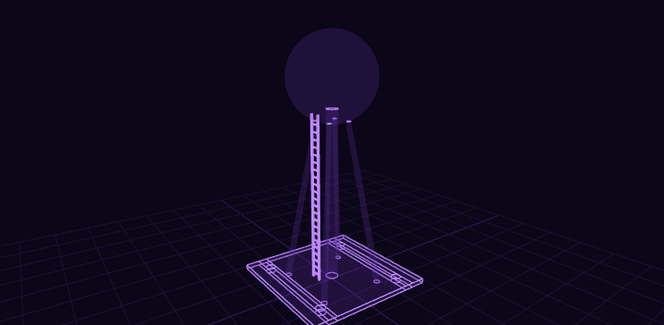

# N O V A

**A voice-driven assistant that runs on your own PC.**

Say *"Nova"*. The panel chimes, listens, and answers out loud — and behind it
is Claude, with real access to the machine. The wake word runs offline,
your voice is transcribed offline, and nothing is billed to an API key, because
there isn't one: it drives the Claude CLI you're already signed into.



---

## What it actually is

Three small processes and a web page:

| Piece | What it does |
|---|---|
| `nova-wake.ps1` | Offline wake-word listener. Hears *"Nova"*, records, hands the audio to Whisper. |
| `nova_bridge.py` | A localhost web server that holds one long-lived Claude session and relays to it. |
| `hud.html` | The panel: diagnostics, transcript, controls, and the projector. |
| `nova-watch.ps1` | A watchdog that keeps the other two alive. The bridge keeps *it* alive in return. |

Nothing here talks to the internet except Claude itself. The wake word,
transcription, speech, rendering and the CAD kernel are all local.

---

## The projector

This is the part that isn't like other voice assistants. When an answer has a
shape, Nova doesn't describe it — she **builds** it, and it lands on the stage
next to her reply.

She writes code against a real solid-modelling kernel (JSCAD), so a window is
a genuine boolean subtraction, a colonnade is a `for` loop, and a wall
thickness is a variable used once:

```js
const walls = subtract(shell, union(
  cuboid({ size: [95, T*4, 210], center: [0, D/2, 105] }),    // door
  cuboid({ size: [130, T*4, 110], center: [-200, D/2, 150] }) // window
));
```



Every part comes back **named**, so each one is individually labelled,
hoverable, clickable and explodable. Hovering reads out measured facts —
*"620 × 280 × 20 cm · base 20 cm up · on the concrete slab · 1 door, 2 windows"* —
taken from the compiled geometry, not from what she claimed she drew.



That tower is four hulled legs from a loop, twenty-two ladder rungs from
another, and four bolt pockets subtracted out of the raft. None of it is
expressible as a list of primitives, which is exactly the point.

**Four block types** she can append to a reply:

- **`::CAD`** — JavaScript against the kernel. Real booleans, loops, functions.
- **`::MODEL`** — a simpler declarative form for plain stacked shapes, where
  you say what each part *sits on* and the compiler does the arithmetic.
- **`::HOLO`** — flat schematics: node graphs, flows, layer stacks, comparisons.
- **`::BUILD`** — a complete working HTML file, running live in a sandbox.

She can also **look at what she made**: a button captures the projection and
hands it back to her as an image, so she can tell you whether it came out
right. She is often blunt about it.

---

## Requirements

- **Windows 10 or 11**
- **Python 3.10+** on `PATH`
- **Node.js** — only for the Claude CLI
- **Google Chrome** — the panel uses its speech synthesis
- **A Claude subscription** (Pro or Max). No API key, no API billing.
- ~1 GB free for the Whisper model

---

## Install

```powershell
# 1. Put it where it lives
git clone https://github.com/<you>/nova-console "$env:USERPROFILE\.nova"
cd "$env:USERPROFILE\.nova"

# 2. Fetch the two browser libraries (three.js + JSCAD, both MIT)
.\fetch-vendor.ps1

# 3. Python dependencies
pip install faster-whisper mss pillow

# 4. The Claude CLI
npm install -g @anthropic-ai/claude-code

# 5. Your settings
Copy-Item config.example.json config.json
```

### Connecting it to your Claude account

This is the only step that involves your account, and **you do it yourself** —
NOVA never sees or stores a credential.

The Claude desktop app keeps its login inside its own sandbox, so the CLI needs
its own sign-in:

```powershell
.\Nova.ps1 login      # opens a console — type /login and finish in the browser
.\Nova.ps1 restart
.\Nova.ps1 status     # should say:  claude   ready
```

That's it. From then on every reply runs on your existing plan through the
CLI. There is no API key anywhere in this project — grep for one and you'll
find nothing, because the bridge only ever spawns `claude` as a subprocess.

### Start it

```powershell
.\Nova.ps1 start      # bridge + wake listener + watchdog
.\Nova.ps1 open       # open the panel
.\Nova.ps1 install    # optional: start automatically at every login
```

Then say **"Nova"**, wait for the rising chime, and talk.

> The pause matters. The wake word fires when you *stop* saying "Nova", so
> saying *"Nova what's my disk space"* in one breath loses the first half. One
> beat is enough. Or turn on **Continuous** and skip the wake word entirely.

---

## Features

**Voice in.** Offline wake word with a decoy list to suppress false fires,
then Windows records and local Whisper transcribes. The browser never touches
the microphone, which is what makes it reliable when a machine has six inputs
all called "Microphone".

**Barge-in.** Saying her name while she's talking cuts her off mid-sentence.
Only the wake word can do this — a cough, the television or someone else
talking can't, because the interrupt lives behind the same offline matcher.

**A core that tells you what she's doing.** Each state has its own colour,
spin rate and ring count — standby, listening, transcribing, thinking,
working, speaking, remembering. Every change is one continuous motion: the
angles are integrated rather than derived, the colour crossfades, and a state
change spikes a surge that winds the rings up and lets them settle, so the
acceleration itself is the notification. When she's genuinely working the core
runs a **prism** — the hue rotates through the spectrum and the saturation
climbs the longer the job goes on. Idle is a calm violet.

**Memory.** She keeps durable facts across sessions in `memory.jsonl` by
emitting a marker at the end of a reply. Say something about yourself once and
it survives a restart.

**Tools.** She can read and search the machine, capture the screen, report
system and network state, control volume and media keys, lock or sleep the PC,
switch her own model, and shut herself down — each through a tested helper
script rather than improvised shell. See [`nova.tools.md`](nova.tools.md),
which is the document she herself reads.

**It stays up.** The watchdog restarts the bridge and wake listener if either
dies; the bridge restarts the watchdog if *it* dies, using a heartbeat so a
wedged watchdog counts as dead too. Hourly housekeeping caps the logs, screen
captures and voice recordings so it can run for months without filling a disk.

---

## Safety

**`power` is the setting that matters.**

```jsonc
"power": "read"   // read files, search the web, change nothing
"power": "full"   // every tool, shell included, auto-approved with no prompt
```

`full` means **anything said near the microphone can run commands on this PC.**
It is genuinely useful and genuinely dangerous. Start on `read`, and only move
to `full` once you understand that.

**What never leaves the machine:** your voice, your screen captures, your
transcripts, your memory file and the bridge token. `.gitignore` excludes all
of it. The bridge makes no outbound requests of its own — the only traffic is
the Claude CLI talking to Anthropic on your existing plan.

**The panel is token-gated** on `127.0.0.1` and the token is generated on
first run.

---

## Everyday commands

```powershell
.\Nova.ps1 status         # what's running, backend health, which model
.\Nova.ps1 start | stop | restart
.\Nova.ps1 open           # open the panel
.\Nova.ps1 model opus     # haiku | sonnet | opus — takes effect next turn
.\Nova.ps1 test           # 12-second microphone check
.\Nova.ps1 logs           # tail the bridge and wake logs
.\Nova.ps1 install        # autostart at login
```

---

## Tuning

| Setting | Note |
|---|---|
| `whisper_model` | `base.en` is the sweet spot on CPU — roughly **4× faster** than `small.en` with near-identical transcripts. `tiny.en` starts dropping words. |
| `model` | `opus` is markedly better at geometry and code; `haiku` is fast and places parts loosely. |
| `stt` | `windows` (recommended) — the wake listener records and Whisper transcribes. |
| `workdir` | The folder Claude may work in. Point it at a project to keep her scoped. |

**Faster transcription on an NVIDIA GPU:** `faster-whisper` will use CUDA if
the runtime libraries are present — `pip install nvidia-cublas-cu12
nvidia-cudnn-cu12`, then set `device="cuda"` in `nova_stt.py`.

---

## Troubleshooting

| Symptom | Cause |
|---|---|
| `claude  unknown` | The CLI isn't signed in. `.\Nova.ps1 login`. |
| Panel says the bridge is unreachable | You restarted it; reload the page. |
| Wake word never fires | `.\Nova.ps1 test`, then `.\Nova.ps1 scan` to pick the right input. |
| She's cut off mid-sentence | Raise the ceilings in `nova-wake.ps1` (`Get-Utterance -Seconds`). |
| `Get-CimInstance` / `systeminfo` errors | Some machines have a corrupt WMI repository. The helper scripts avoid WMI entirely for exactly this reason. |

---

## Credits

[three.js](https://threejs.org) (MIT) renders the projections.
[JSCAD](https://github.com/jscad/OpenJSCAD.org) (MIT) is the solid-modelling
kernel. [faster-whisper](https://github.com/SYSTRAN/faster-whisper) (MIT) does
transcription. Claude is by [Anthropic](https://claude.com).

Released under the [MIT Licence](LICENSE).
